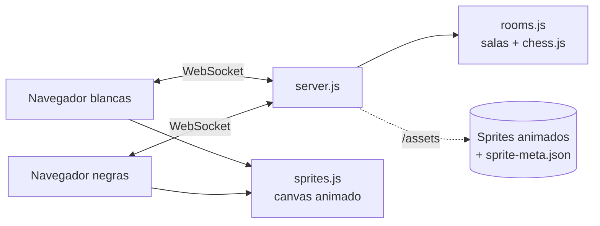

# PokéChess — Ajedrez, damas, damas chinas y Ruta de Medallas Pokémon online

Ajedrez para 2 jugadores en tiempo real donde las piezas son Pokémon **animados** estilo
*Mundo Misterioso*: respiran en reposo, caminan hasta su casilla y, al comerse otra pieza,
**atacan** mientras la víctima recibe el golpe y se debilita.

- Cuatro juegos: **ajedrez**, **damas** (8×8), **damas chinas** (estrella) y **Ruta de Medallas** (juego de tablero de 2 a 4 jugadores), online o contra bots.
- Cada jugador elige **su propia generación** (I, II, III o IV) y sus piezas opcionales (se puede jugar Gen I contra Gen IV).
- **Pokéreloj**: chat de la sala con reacciones y registro, en forma de reloj pixel art.
- El anfitrión elige el **tablero**: lugares icónicos del mundo Pokémon (o aleatorio).
- Las blancas llevan una **Honor Ball** bajo los pies y las negras una **Ocaso Ball**, además del sprite **shiny**. Sin sombras.
- **Modo contra el bot** con tres dificultades: Fácil, Normal y Difícil.
- **Modo atento** (por defecto): puedes dejar a tu rey en peligro y nadie te avisa; si el rival se lo come, gana.
- Logo, Poké Ball y robot en **pixel art**.

## Piezas

| Pieza | Generación I (Kanto) | Generación II (Johto) |
|---|---|---|
| Peón | Caterpie | Weedle |
| Caballo | Tauros **o** Rapidash | Arcanine **o** Ninetales |
| Alfil | Arbok **o** Onix | Kingdra |
| Torre | Snorlax | Tyranitar |
| Reina | Mew | Lugia |
| Rey | Mewtwo | Ho-Oh |

| Pieza | Generación III (Hoenn) |
|---|---|
| Peón | Wurmple |
| Caballo | Donphan **o** Girafarig |
| Alfil | Huntail |
| Torre | Registeel |
| Rey y reina (en pareja) | **Groudon y Kyogre** o **Latios y Latias** |

En Gen III el rey y la reina se eligen juntos: al escoger Latios, la reina pasa a ser Latias.

| Pieza | Generación IV (Sinnoh) |
|---|---|
| Peón | Bidoof |
| Caballo | Luxray |
| Alfil | Milotic |
| Torre | Probopass |
| Reina | Dialga |
| Rey | Palkia |

En damas, la Gen IV usa **Gible** que al coronar evoluciona a **Garchomp**; en damas chinas sus 10 fichas son
Turtwig, Chimchar, Piplup, Shinx, Buneary, Pachirisu, Glameow, Riolu, Munchlax y Gible.

## Ruta de Medallas

Juego de tablero original para **2 a 4 jugadores** (amigos y/o bots). Cada jugador elige **cualquier Pokémon que sea el
primero de su línea evolutiva** (regla estricta: Pichu sí, Pikachu no; 504 elegibles, datos de PokeAPI) y si lo quiere **shiny**.
El anfitrión elige las **medallas para ganar (3 a 8, por defecto 8)**, los bots y su dificultad, y el tablero.

**Turno**: tiras dos dados y tu Pokémon camina. Con dobles vuelves a tirar (máx. 2 veces). Pasar por la Salida da +200 ₽.

**Tablero de 44 casillas** (cuadrícula de 12×12) por cinco regiones —Kanto, Johto, Hoenn, Sinnoh y **Teselia**—:

| Casilla | Qué pasa |
|---|---|
| Pueblo (15) | Se reclama. Quien cae en uno ajeno paga entrenamiento; ×2 si el dueño tiene la región entera |
| Gimnasio (9) | Desafías al líder (tus dados contra los suyos; el empate gana el retador). Medallas **personales**: si ya tienes esa, luchas por la siguiente que te falte. Cada derrota da +1 de experiencia (máx. +3) |
| Transporte (4) | Magnetotren, Ferry S.S. Aqua, Teleférico, Metro Batalla. Billete 30/60/110/180 ₽ según cuántos tenga el dueño. Si caes en uno tuyo, **viajas gratis** a otro de los tuyos |
| Servicio (2) | Central Eléctrica y Torre Radio: se paga lo de los dados ×4 (×10 si el dueño tiene los dos) |
| Hierba alta (3) | Evento animado con un Pokémon salvaje (ver abajo) |
| Árbol de Bayas (3) | Evento animado de bayas (ver abajo) |
| Equipo Galaxia (2) | Te roban dinero o una propiedad (Scyther del Safari te protege) |
| Monte Corona | **Atajo** por la cueva que cruza el centro del tablero hasta Ciudad Rocavelo: puede salir bien o devolverte a la entrada |
| Zona Safari | Entrada 50 ₽ y 3 Safari Balls para capturar un Pokémon con un bonus de un uso |
| Centro Pokémon / Tienda | Bono de 50 ₽ / comprar una Poké Flauta |
| Snorlax dormido | Si te mandan allí te quedas atascado hasta sacar dobles, usar una Poké Flauta o Baya Zreza, o 3 turnos |

- **Hierba alta**: Snorlax dormido, Ponyta (¡vuelve a tirar!), Abra (teletransporte), Meowth (Día de Pago), Pidgey (vuelo al Centro), Geodude (retrocedes), Gastly (pierdes turno), Chansey, Poké Flauta, Zubat.
- **Árbol de Bayas**: Aranja, Zreza (se guarda), Meloc (avanza), Atania (retrocede), Zidra (al Centro), ¡Bayas para todos!, Fiesta de bayas, Aipom te roba, Caquic (pierdes turno).
- **Monte Corona**: Onix cava un túnel, objeto escondido, Poké Flauta (cruzas) · Geodude, Zubat, Bronzor (vuelves a la entrada).
- **Zona Safari**: Kangaskhan (+120 ₽), Tauros (avanza 3), Chansey (al Centro), Scyther (protege del Equipo Galaxia), Pinsir (recupera gratis de la Guardería), Exeggcute (vuelve a tirar) y Dratini, rarísimo (desafío de gimnasio extra).
- **Combate**: si caes donde hay otro jugador puedes retarle; los dos tiran los dados, el ganador **ataca** y el perdedor **retrocede** a la casilla donde estaba antes.
- **Si no puedes pagar**: dejar propiedades en la **Guardería** (recibes el 50 %, no cobran; recuperarlas cuesta el 60 %), **venderlas a otro jugador** (él acepta o rechaza; caduca en 30 s) o **a la Tienda Pokémon** (40 %), o **retirarte** (tus bienes pasan a quien le debías).
- **Gana** quien llega a las medallas objetivo, el último con dinero, o el de más patrimonio al acabar las rondas (15 + 6 × medallas).
- **Bots** (Fácil / Normal / Difícil): reclaman, combaten, cruzan la cueva, entran al Safari, viajan, usan sus Pokémon capturados y salen de deudas.

**Tablero dinámico**: suelo de baldosas en pixel art, árboles, flores, estanque, la Zona Safari con su valla y el sendero de cueva del
atajo con su cartel; Pokémon salvajes paseando; **día, tarde, atardecer y noche** según la ronda (de noche se encienden los faroles);
casillas que se iluminan al caminar, monedas que vuelan al pagar, medallas, confeti al reclamar, dados que giran y foco en el turno.
Los avisos de eventos aparecen arriba y se apartan solos; la tarjeta central solo muestra el turno y los dados.

## Pokéreloj (chat)

Reloj pixel art en una esquina, en el lobby y en la partida de todos los juegos. El botón lateral cambia de pantalla:
**Chat** (con el mini sprite de cada jugador y "escribiendo…"), **Reacciones** (¡GG!, ¡Bien jugado!, ¡Eso dolió!…: el Pokémon de quien
la manda actúa sobre el tablero) y **Registro** de la partida. Plegado avisa de los mensajes sin leer. Se guardan los últimos 50
mensajes; máximo 200 caracteres y 1 mensaje por segundo; el texto se muestra siempre como texto (sin HTML).

## Damas

Damas clásicas en el tablero de 8×8 (casillas oscuras), 12 fichas por jugador. Blancas mueven primero.

- Las fichas avanzan **una casilla en diagonal** hacia delante y comen saltando hacia delante, encadenando capturas.
- **Comer es libre** (por defecto): comes solo si quieres, y en una cadena de saltos puedes parar en cualquier salto.
- Opción **Comer obligatorio** en el lobby (la elige el anfitrión): si puedes comer, tienes que comer (las fichas que pueden se marcan con un aro discontinuo) y la cadena se completa entera.
- Al llegar al fondo la ficha **corona y evoluciona**: la dama se mueve y come una casilla en **cualquier diagonal**. Si corona en mitad de una cadena, la jugada termina ahí.
- **Gana** quien deja al rival sin fichas o sin movimientos. **Tablas** tras 80 jugadas seguidas sin capturas.
- Animación: la ficha camina en diagonal; en cada captura **ataca** y la ficha comida se debilita; al coronar brilla y evoluciona.

| Generación | Ficha | Dama (evolución) |
|---|---|---|
| I | Magikarp | Gyarados |
| II | Chinchou | Lanturn |
| III | Bagon | Salamence |

**Bot de damas** (`server/draughtsBot.js`): negamax con poda alfa-beta. Valora fichas (100), damas (170), avance, centro y la guardia de la última fila.
Fácil mueve casi al azar (aunque si puede comer, suele comer); Normal mira 4 jugadas; Difícil hasta 8 jugadas con límite de tiempo. Al final de la búsqueda sigue mirando las capturas pendientes (búsqueda de quietud) para no cortar a mitad de un intercambio.

## Damas chinas

Tablero de estrella de 121 huecos para 2 jugadores, en puntas opuestas, con 10 fichas cada uno.

- En tu turno mueves una ficha a un **hueco vecino** o **saltas** por encima de cualquier ficha (tuya o rival) a un hueco libre justo detrás, **encadenando** todos los saltos que quieras.
- **Gana** quien llena la punta contraria con al menos una ficha propia dentro (así nadie puede bloquearte dejando fichas en tu meta).
- **Tablas** a las 200 jugadas.
- Al seleccionar una ficha se marcan todos sus destinos; las fichas caminan hueco a hueco y dan saltitos en los saltos.
- Quien juega con negras ve la estrella girada, con sus fichas abajo.

| Generación | Las 10 fichas |
|---|---|
| I | Pikachu, Bulbasaur, Charmander, Squirtle, Eevee, Jigglypuff, Psyduck, Meowth, Clefairy, Gengar |
| II | Chikorita, Cyndaquil, Totodile, Togepi, Marill, Pichu, Mareep, Sneasel, Teddiursa, Umbreon |
| III | Treecko, Torchic, Mudkip, Ralts, Skitty, Mawile, Aron, Plusle, Minun, Absol |

**Bot de damas chinas** (`server/checkersBot.js`): mide cuánto le falta a cada bando (distancia de cada ficha al vértice de su meta, castigando la ficha más atrasada).
Fácil elige al azar entre las 5 jugadas que más avanzan; Normal elige la que deja mejor posición; Difícil también piensa en tu mejor respuesta.

## Tableros

Ruta 1 · Pueblo Paleta · Monte Moon · Gimnasio de Ciudad Plateada · Torre Campana · Islas Remolino · Meseta Añil.
Son dibujos propios hechos con CSS (`.theme-<id>` en `public/style.css`).

## Instalar y arrancar

Requisitos: Node.js 18 o superior.

```bash
npm install
npm start
```

Abre <http://localhost:3000>. El puerto se cambia con la variable `PORT`.
Los sprites están incluidos en el proyecto: no hace falta internet para verlos.

## Cómo jugar

1. Escribe tu nombre, elige **juego** (ajedrez o damas chinas) y tu generación, y pulsa **Crear sala online**. Juegas con blancas (Honor Ball).
2. Comparte el **código de 5 letras** o **Copiar link** con tu rival.
3. Tu rival elige su generación y entra con el código. Juega con negras (Ocaso Ball, shiny).
4. En el lobby: cada uno puede cambiar su generación y sus variantes (caballo/alfil); el anfitrión elige el tablero. Pulsad **¡Listo!**.
5. Clic en una pieza para ver sus jugadas legales y clic en el destino. Al coronar eliges la pieza viendo los Pokémon.
6. Al terminar (mate, tablas o rendición) pulsad **Revancha**: volvéis al lobby con los colores intercambiados.

### Reglas: modo atento o clásico

El anfitrión (o tú, contra el bot) elige las reglas en el lobby:

| | Modo atento (por defecto) | Clásico |
|---|---|---|
| ¿Puedo dejar a mi rey en peligro? | Sí | No |
| Aviso de jaque | No (ni brillo rojo, ni "¡Jaque!", ni "+" en el historial) | Sí |
| Cómo se gana | **Comiéndose al rey** rival | Jaque mate |
| Tablas | Material insuficiente o regla de 50 jugadas | Además ahogado y triple repetición |

En modo atento, al seleccionar una pieza se marcan también las casillas que dejan a tu rey expuesto.
El bot, en cualquier dificultad, se come a tu rey si lo dejas a tiro, y nunca deja el suyo en peligro.

### Contra el bot

1. En el inicio pulsa **🤖 Jugar contra el bot** (usa la generación que tengas elegida).
2. En el lobby elige **dificultad**, **tu color** (blancas, negras o aleatorio), el **tablero** y también la **generación y piezas del bot** (o 🎲 al azar).
3. Pulsa **¡A jugar!**. Cuando le toca, el bot muestra "pensando…" y mueve tras una breve pausa, con las mismas animaciones de caminar y atacar.
4. La revancha la acepta solo y se mantiene el color que elegiste.

| Dificultad | Cómo juega |
|---|---|
| Fácil | Casi al azar, pero si puede comer una pieza come la más valiosa (y nunca deja pasar un mate en 1) |
| Normal | Mira 2 jugadas por adelantado, con algo de variedad entre jugadas parecidas |
| Difícil | Mira hasta 4 jugadas por adelantado (profundización iterativa, máx. 2,5 s) |

Si recargas la página vuelves a tu asiento (el token se guarda por pestaña en `sessionStorage`).

## Animaciones

Cada hoja de sprites tiene los fotogramas en columnas y 8 direcciones en filas.
`assets/sprite-meta.json` indica para cada Pokémon y animación el tamaño de fotograma,
cuántos hay, cuánto dura cada uno y el punto de anclaje (los pies).

| Momento | Animación |
|---|---|
| En reposo | `Idle` mirando al frente |
| Al mover | `Walk` en la dirección del movimiento mientras se desliza hasta la casilla (en el enroque camina también la torre) |
| Al capturar | El atacante hace `Attack` o `Shoot` (al azar); la víctima hace `Hurt`, luego `Faint`, y desaparece |

Para que **todas las casillas y piezas tengan la misma dimensión**, se mide la caja visible del primer
fotograma de reposo de cada Pokémon y se escala para ocupar el mismo espacio en su casilla.
Con "reducir movimiento" activado en el sistema, las piezas no se animan.

## Cómo piensa el bot (`server/bot.js`)

- **Búsqueda minimax con poda alfa-beta** (negamax): prueba sus jugadas, las respuestas del rival, etc., y descarta ramas que ya sabe peores.
- **Evaluación**: material (peón 100, caballo 320, alfil 330, torre 500, dama 900) + tablas de casillas que premian centralizar, desarrollar y enrocar.
- **Orden de jugadas**: primero coronaciones y capturas (víctima valiosa con atacante barato), para podar antes.
- **Profundización iterativa con límite de tiempo**: si se acaba el tiempo usa la última profundidad completa, así nunca se queda colgado.
- **Rendimiento**: dentro de la búsqueda usa los métodos internos de chess.js (`_moves`, `_makeMove`, `_undoMove`), entre 10 y 20 veces más rápidos que la API pública. Por eso `package.json` fija **chess.js 1.0.0** exacto.
- Corre en el servidor (que sigue siendo la autoridad). `server.js` lo llama cuando `room.botToMove()` indica que le toca, tras una pausa de 0,9 s.

## Jugar online

- **Misma red Wi-Fi:** tu rival abre `http://TU-IP-LOCAL:3000`.
- **Internet:** desplegado en Render (servicio web Node, `npm install` / `npm start`). El WebSocket usa la misma URL (`/ws`) con `wss`.
  En el plan gratuito el servidor se duerme tras un rato sin uso: la primera visita tarda ~30 s y las salas se pierden al reiniciarse.

## Estructura

```
pokechess/
├─ server/
│  ├─ server.js      Express (archivos + sprites) y WebSocket /ws
│  ├─ rooms.js       Salas, generación por jugador, tablero, turnos, reglas y asiento del bot
│  ├─ bot.js         Cerebro del bot de ajedrez (minimax alfa-beta, 3 dificultades)
│  ├─ draughtsBot.js Bot de damas (alfa-beta)
│  ├─ checkersBot.js Bot de damas chinas
│  ├─ routeRoom.js   Sala de Ruta de Medallas (4 asientos, bots, ofertas)
│  ├─ routeBot.js    Bot de Ruta de Medallas
│  └─ errors.js      Error que se muestra al jugador
├─ shared/
│  ├─ generations.js Pokémon de cada pieza por generación (Node y navegador)
│  ├─ boards.js      Lista de tableros temáticos
│  ├─ draughts.js    Reglas de las damas (Node y navegador)
│  ├─ checkers.js    Reglas de las damas chinas (Node y navegador)
│  └─ route.js       Reglas de Ruta de Medallas (Node y navegador)
├─ public/
│  ├─ index.html     Pantallas: inicio, lobby y partida
│  ├─ app.js         Cliente: conexión, lobby, tablero, animación de jugadas
│  ├─ sprites.js     Dibujo y animación de sprites en <canvas>
│  ├─ route-ui.js    Interfaz de Ruta de Medallas (tablero dinámico, panel, efectos)
│  ├─ poketch.js     Pokéreloj (chat, reacciones, registro)
│  ├─ style.css      Estilos y tableros temáticos
│  ├─ fonts/         Pixelify Sans (OFL)
│  └─ img/           Poké Balls, robot, icono y props/ (escenario pixel art)
├─ tools/
│  └─ make-props.js  Genera los elementos pixel art del escenario
├─ assets/
│  ├─ pokemon/       966 Pokémon × animaciones (normal y shiny/s)
│  ├─ sprite-meta.json
│  └─ base-forms.json Pokémon elegibles en Ruta de Medallas (primeros de su línea)
└─ test/             Pruebas con node --test
```



El **servidor es la autoridad**: comprueba que sea tu turno y que la jugada sea legal
(enroque, al paso, coronación) y detecta jaque mate, ahogado, triple repetición,
material insuficiente y la regla de 50 jugadas.

### Protocolo WebSocket (JSON)
| Cliente → servidor | Para qué |
|---|---|
| `create {gen, name, game}` | crear sala con tu generación; `game`: `chess` · `checkers` |
| `createBot {gen, name, level, game}` | partida contra el bot (`easy` · `normal` · `hard`) |
| `game {game}` | (anfitrión) `chess` · `draughts` (damas) · `checkers` (damas chinas) |
| `botOptions {level?, gen?, choices?, random?}` | (contra el bot) dificultad, generación y piezas del bot |
| `color {pref}` | (contra el bot) tu color: `w` · `b` · `random` |
| `rules {attentive}` | (anfitrión) modo atento (`true`) o clásico (`false`) |
| `drRules {forced}` | (anfitrión, damas) comer obligatorio (`true`) o libre (`false`) |
| `join {code, name, gen}` | unirte con tu generación |
| `resume {code, token}` | volver tras recargar |
| `gen {gen}` | cambiar **tu** generación |
| `board {board}` | (anfitrión) tablero: id de `shared/boards.js` o `random` |
| `choose {choices}` | variantes, p. ej. `{ n: 1, b: 0 }` |
| `ready {ready}` | listo / no listo |
| `move {from, to, promotion, path}` | mover (en damas, `path` desempata cadenas; en damas chinas `from`/`to` son huecos `"q,r"`) |
| `resign`, `rematch` | rendirse / revancha |
| `chat {text}` · `react {kind}` · `typing` | Pokéreloj (todas las salas) |
| `pick {mon, shiny}` · `addBot` · `removeBot {seat}` · `target {n}` | Ruta de Medallas: lobby |
| `route {action}` | Ruta de Medallas: `roll`, `buy`, `skip`, `battle`, `decline`, `shop`, `cave`, `safari`, `travel`, `useItem`, `useSafari`, `end`, `daycare`, `redeem`, `sellBank`, `offer`, `answer`, `cancelOffer`, `retire` |

El servidor responde con `joined {code, token, color}`, `state {state}` o `error {message}`.

## Añadir una generación

Ya están descargados los sprites de 966 Pokémon. Solo hay que añadir una entrada en
`shared/generations.js` con el número de Pokédex de cada pieza:

```js
3: {
  name: 'Generación III', region: 'Hoenn',
  pieces: { p: [{ id: 265, name: 'Wurmple' }], n: [...], b: [...], r: [...], q: [...], k: [...] },
},
```

## Pruebas

```bash
npm test
```

71 pruebas. De Ruta de Medallas: tablero de 44 casillas, jugadores y medallas, reclamar y cobrar (región ×2, Guardería), salida y dobles, gimnasios y experiencia, victoria por medallas, combates y retroceso, cada evento de hierba alta y de bayas, Snorlax, transportes y viajes, servicios, el atajo del Monte Corona, la Zona Safari y cada bonus, deudas y ventas (aceptar, rechazar, caducar), retirarse, el bot en partidas de 2 y 4, la regla estricta de primera fase, la sala de 4 y una partida por WebSocket con el chat del Pokéreloj. De la Gen IV: sus piezas en los tres juegos. De damas: posición inicial, avance en diagonal, comer libre (no comer y cortar cadenas), captura obligatoria como opción y quién la elige, cadenas de capturas, coronación, la dama come hacia atrás, victoria sin fichas o sin movimientos, el bot juega legal y elige la captura doble, y la sala de damas. De damas chinas y Gen III: tablero de 121 huecos, pasos y saltos encadenados, validación de jugadas, victoria al llenar la meta, el bot juega legal y termina partidas, sala con bot y cambio de juego, y la pareja rey/reina de Gen III. Del modo atento: está activo por defecto y solo lo cambia el anfitrión, se puede ignorar el jaque y comerse al rey gana, el "mate" no termina la partida, las reglas clásicas siguen igual, el bot se come un rey desprotegido y mueve aunque no tenga jugadas legales. Del bot: siempre juega legal (partidas bot contra bot), todos los niveles ven el mate en 1,
Normal/Difícil se comen una dama regalada, Fácil come lo más valioso, corona, respeta su tiempo,
la sala con bot (opciones, color, revancha automática) y una partida por WebSocket donde el bot contesta solo.
Del resto: piezas por generación, generación por jugador, tablero (solo anfitrión, aleatorio),
salas, variantes, turnos, jugadas ilegales, mate del pastor, rendición y revancha, coronación,
que no se filtren tokens, una partida completa por WebSocket con reconexión, y que estén los
966 Pokémon y que las hojas de cada pieza cuadren con sus metadatos.

## Cambios

**v8.3 — botón Salir**
- Botón "← Salir" arriba en todas las salas (y el botón atrás del navegador): en el lobby libera tu asiento; en partida pide confirmación y cuenta como rendición (en Ruta de Medallas, retirarse). El anfitrión pasa al siguiente humano y la sala se cierra si no quedan humanos. Los demás ven un aviso.

**v8.2 — Pokéreloj plegado**
- El botón rectangular se cambia por un icono redondo en pixel art (reloj rojo con pantalla verde y bocadillo de chat, `img/props/poketch.svg`).
- Globito amarillo con los mensajes sin leer y una pequeña vibración al llegar uno; etiqueta "Pokéreloj · chat" al pasar el ratón.
- El reloj grande se abre desde el icono y se encoge al cerrarse. En móvil queda espacio al final de la página para que no tape botones.

**v8.1 — Pokémon salvajes fluidos**
- Cada Pokémon salvaje del escenario tiene una sola animación (antes se le creaba otra en reposo que a ratos lo hacía mirar al frente).
- Caminan mirando hacia donde van (fila derecha/izquierda de su sprite), se dan la vuelta al llegar al borde y a veces se paran mirando de lado; Pidgey vuela con vaivén.
- Marco más grande para que no se recorten y carriles que no cruzan el cartel del atajo ni la tarjeta central.

**v8 — Ruta de Medallas, Pokéreloj y Generación IV**
- Nuevo juego: **Ruta de Medallas** (2-4 jugadores, bots, 44 casillas, Teselia, transportes, servicios, Monte Corona, Zona Safari, combates, Guardería y ventas).
- **Pokéreloj**: chat, reacciones y registro en todas las salas.
- **Generación IV** en ajedrez (Palkia, Dialga, Luxray, Milotic, Probopass, Bidoof), damas (Gible→Garchomp) y damas chinas.
- Tablero dinámico en pixel art estilo PokéSurvivor (dibujos propios generados con `tools/make-props.js`) y fuente Pixelify Sans.

**v7 — comer libre e icono**
- Damas: comer ya no es obligatorio (y las cadenas se pueden cortar). La regla clásica sigue disponible como opción "Comer obligatorio".
- Icono de pestaña en pixel art: un caballo de ajedrez con los colores de una Poké Ball (`public/img/favicon.svg`).

**v6 — damas**
- Nuevo juego: damas clásicas en el tablero de 8×8, online y contra el bot (3 dificultades).
- Fichas que evolucionan al coronar: Magikarp→Gyarados, Chinchou→Lanturn, Bagon→Salamence.
- Arreglado: los Pokémon de las tarjetas de generación se salían de la tarjeta; ahora se encogen para caber y las tarjetas se reparten según el ancho.

**v5 — damas chinas y Generación III**
- Nuevo juego: damas chinas en tablero de estrella, online y contra el bot (3 dificultades).
- Generación III para el ajedrez con rey y reina en pareja (Groudon/Kyogre o Latios/Latias).
- Selector de juego en el inicio y en el lobby (lo cambia el anfitrión).
- Si una hoja shiny de origen no cuadra con sus metadatos (Faint de Girafarig), se usa la normal.

**v4 — modo atento**
- Nueva regla por defecto: se puede dejar al rey en peligro, sin avisos; comerse al rey gana la partida.
- El bot se come un rey desprotegido y, sin jugadas legales, mueve igualmente.
- Arreglado: si llegaba una jugada mientras se animaba una captura, el sprite de la pieza comida se quedaba debajo de otra. Ahora la animación anterior se termina al instante y se borra cualquier sprite sin pieza real.
- El bot espera a que termine la animación de captura antes de mover.
- Logo (Poké Ball y título) y robot del bot en pixel art.

**v3 — bot**
- Botón "Jugar contra el bot" con dificultad Fácil / Normal / Difícil.
- Eliges tu color y la generación y piezas del bot (o al azar).
- Indicador "pensando…", revancha automática, sala se limpia si te vas.
- chess.js fijado a 1.0.0 (el bot usa sus métodos internos).

**v2**
- Cada jugador elige su generación (antes la elegía el anfitrión para los dos).
- Sprites animados de SpriteCollab (vía PokéSurvivor) en lugar de imágenes fijas: reposo, caminar, ataque al capturar, daño y derrota.
- Casillas y piezas del mismo tamaño.
- Sin sombras: insignia de Honor Ball (blancas) y Ocaso Ball (negras).
- Tableros de lugares icónicos.
- Descargada la colección completa (966 Pokémon) para próximas generaciones.

## Créditos y licencia

Los sprites son de [SpriteCollab](https://github.com/PMDCollab/SpriteCollab), con licencia CC BY-NC 4.0 (no comercial y con atribución).
Se tomaron de [PokéSurvivor](https://github.com/JPTER78/pokesurvivor). Los artistas aparecen en [CREDITS.md](CREDITS.md).
Pokémon pertenece a Nintendo, Creatures Inc., GAME FREAK y The Pokémon Company.
Este es un proyecto de fans sin ánimo de lucro.
